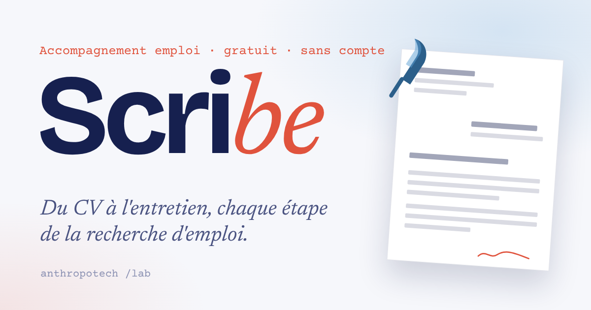

# Scribe, page de présentation

**Du CV à l'entretien, chaque étape de la recherche d'emploi. Rien n'est collecté.**

Un CV écrit à la hâte. Une lettre qui commence par « Je ». Une candidature envoyée, puis oubliée. Scribe reprend chaque étape, de la première ligne du CV jusqu'à la relance, et aide à bien la faire.

Ce dépôt contient la page de présentation de Scribe, outil d'accompagnement à la recherche d'emploi, gratuit et sans compte.

  
  

## Le parcours

Profil, CV, lettre, candidature, relance (entre J+10 et J+14), entretien, succès : Scribe suit une campagne de recherche, pas une pile de documents.

## Ce que présente la page

| Rubrique | Contenu |
|:--|:--|
| Mon CV | Chronologique ou thématique, aperçu mis à jour à chaque frappe, export PDF en un clic |
| Ma lettre | Une consigne précise préparée pour ChatGPT à partir de l'offre et du profil, puis un PDF mis en page selon la méthode Vous, Moi, Nous |
| Mes candidatures | Statut, date de relance et notes pour chaque candidature, calendrier, export CSV |
| L'entretien | Simulateur de questions par thème, checklist, fiche de préparation en PDF, bilan après l'entretien |
| La lettre au millimètre | Présentation inspirée de la norme AFNOR NF Z 11-001 : A4, marges de 25 mm, destinataire à 105 mm du bord |
| Pour tout le monde | Mode sombre, contraste élevé, police adaptée à la dyslexie, taille du texte réglable, lecture à voix haute |

## Vos données

- CV, lettres, candidatures et bilans restent enregistrés dans le navigateur, sur l'appareil.
- Aucun compte, aucun serveur qui garde les documents, aucun cookie, aucun traceur, aucune publicité.
- ChatGPT seulement si l'utilisateur le décide : il colle lui-même la consigne, après l'avoir relue.
- Un bouton efface toutes les données Scribe du navigateur, à tout moment.

## Principes de la page de présentation

- Aucun cookie, aucun traceur, rien d'enregistré dans le navigateur.
- Captures réalisées avec une candidate fictive.
- Page non référencée par les moteurs de recherche.

## Technique

Page statique en HTML, CSS et JavaScript, sans dépendance, hébergée sur GitHub Pages. Polices Bricolage Grotesque, Newsreader et Courier Prime sous licence SIL Open Font License 1.1 (voir `fonts/OFL.txt`).

---

Scribe, projet d'Anthropotech Lab. Conçu et développé par Shams &amp; Dean. 
© 2026 Shams Guettaf, Anthropotech Lab. Tous droits réservés. Voir <a href="LICENSE">LICENSE</a> et les <a href="https://shamsetdean.github.io/scribe-presentation/mentions-legales.html">mentions légales</a>.
